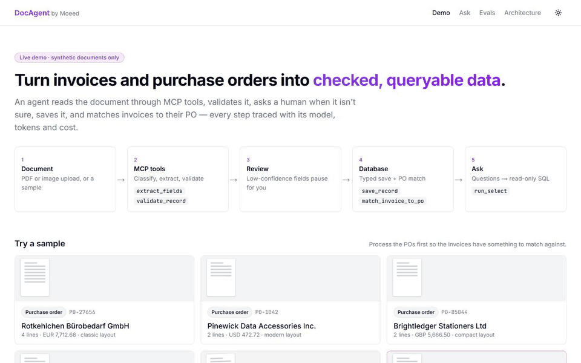
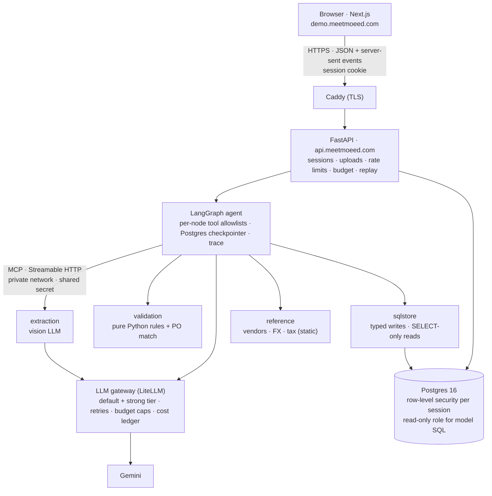

# DocAgent

**An agentic document-to-data pipeline on MCP — extraction, validation, human review and SQL
Q&A, with live traces, cost control and measured accuracy.**

**Live demo: [demo.meetmoeed.com](https://demo.meetmoeed.com)** · API:
[api.meetmoeed.com/api/health](https://api.meetmoeed.com/api/health) · Synthetic documents only.



## The problem

Accounts-payable teams still re-key invoices and purchase orders by hand, then check every
invoice against its PO line by line. Pointing a language model at the PDF gets you most of the
way, but not to something you can trust: the model misreads a digit, invents a missing value
with full confidence, and nobody can say afterwards why a document was approved.

DocAgent treats the model as one careful reader in a pipeline rather than the decision-maker:

- every extracted field carries a **confidence, a source page and an evidence snippet**;
- **deterministic rules** (totals add up, dates, formats, vendor master, PO tolerances) decide
  whether a document is right — not another prompt;
- only the **flagged fields** go to a stronger model, and if it's still unsure, a **human**
  reviews just those fields;
- the record is saved through a **typed** tool, matched against its PO, and becomes
  **queryable in plain English** via read-only SQL;
- every step is **traced live** with its tool, arguments, model, tokens, latency and cost, and
  a gateway **caps spend** per session and per day.

Documents are invoices and purchase orders from fictional office/IT suppliers, generated for
this project.

## How it works



The ingest graph: `classify → extract → validate → (re-extract flagged fields on the strong
tier) → (human review) → save → PO match → summarize`. The ask graph plans one `SELECT`,
runs it through sqlstore's guarded pipeline (fixing it from the error at most twice) and
phrases a one-line answer.

| MCP server | Tools | Model? |
|---|---|---|
| [extraction](servers/extraction/README.md) | `classify_document`, `extract_fields`, `reextract_fields` | vision LLM, via the gateway |
| [validation](servers/validation/README.md) | `validate_record`, `match_invoice_to_po`, `list_rules` | no |
| [sqlstore](servers/sqlstore/README.md) | `get_schema`, `run_select`, `save_record`, `get_purchase_order`, `save_match_result` | no |
| [reference](servers/reference/README.md) | `lookup_vendor`, `convert_currency`, `lookup_tax_rate` | no |

## Evaluation

The full eval runs every document through the same pipeline as the demo (reviews are
auto-approved) and scores each field against ground truth. Run 2026-11-14, 65 documents,
default tier `gemini-3.5-flash-lite`, strong tier `gemini-4-hydrogen`.

| Metric | Result |
|---|---|
| Field accuracy (all fields, all documents) | **99.3%** |
| Field accuracy — invoices (33) / purchase orders (32) | 100.0% / 98.8% |
| Clean (54) / scanned (11) documents | 99.2% / 100.0% |
| Classification accuracy | 100% |
| PO match status accuracy | 100% |
| PO mismatch recall (price drift, over-billed quantity, wrong vendor) | **100%** (each kind 100%) |
| Escalated to the strong tier / sent to human review | 4.6% / 4.6% |
| Cost per document (average / max) | **$0.0069** / $0.0218 |
| Latency per document (p50 / p95) | 9.9 s / **21.9 s** |
| Failed runs | 0 |

> **The dataset is synthetic.** These are generated documents in a handful of layout
> templates, with injected mismatches and rasterised "scanned" variants. The numbers show
> the pipeline handles those layouts well — not that it would on real-world documents. The
> remaining errors are two PO fields on one compact template (`ship_to` 71.9%, `buyer.name`
> 78.1%) where the labels are ambiguous. More layout templates and noisier scans are planned.

How fields are scored, and how to run the evals: [evals/README.md](evals/README.md). The
latest report is also served at `/api/evals/latest` and shown on the demo's Evals tab.

## Design decisions

- **Deterministic validation instead of an LLM judge.** Totals, dates, formats, vendor
  lookups and PO tolerances are plain Python rules with tests: cheap, reproducible and
  auditable, and a model can't talk its way past them. The LLM reads; code decides.
- **Selective re-extraction instead of full retries.** When validation flags fields, only
  those field paths go back to the stronger, pricier tier. Most documents never escalate;
  the ones that do pay for a few fields, not a page. If the strong tier is still unsure (or
  unavailable), a human decides.
- **Row-level security for isolation.** Every visitor gets an anonymous 24-hour session;
  every query runs with the session id set, and Postgres RLS filters by it. Model-written
  SQL runs as a separate read-only role with a 3-second timeout and a row cap, so a bad
  query can neither see another session's data nor change anything. Writes go only through
  typed tools.
- **Replay mode.** The six samples have recorded runs. When the daily budget is used up or
  live processing is switched off, the demo replays them with their original timing and says
  so on screen, instead of failing.
- **MCP servers as separate processes.** Each capability is a service with its own
  credentials and blast radius: of the tools, only sqlstore touches the database and only
  extraction sends a document to a model. The agent has per-node tool allowlists (classify
  and extract can't reach sqlstore), and document text is fenced as untrusted data in every
  prompt, so a prompt-injected PDF has nothing dangerous to call.
- **One gateway for every model call.** Tiering, retries with the provider's retry hints,
  per-session/daily/eval budget caps and a cost ledger live in one package; nothing else
  talks to a provider SDK.

More in [SPEC.md](SPEC.md), including the decision log (§13).

## What I'd do in production

- **On-prem model.** Swap the hosted model for a vision-language model on a local GPU behind
  the same gateway, and drop every external API — the MCP boundaries, validation, review flow
  and evals stay as they are.
- **SSO and roles.** Replace anonymous sessions with SSO (OIDC/SAML), and map reviewers,
  approvers and read-only analysts to roles enforced in the same RLS policies.
- **Audit log.** An append-only record of every extraction, rule result, model call and human
  edit with who/when/why — the trace table is the start of this, but it expires with the
  session today.
- **PII redaction.** Detect and mask personal data (names, bank details, addresses) before
  anything reaches a model or a log, with the mapping kept server-side.
- **Real data, measured.** An eval set from real (consented, redacted) documents, more
  templates, calibrated confidences, drift monitoring, and an approval workflow with
  thresholds per vendor.
- **Operations.** Managed Postgres with point-in-time recovery, secrets in a vault, a queue
  for ingest jobs, horizontal API workers, and alerting on cost, latency and review backlog.

## Running it

Local development (Python 3.12 with [uv](https://docs.astral.sh/uv/), Docker for Postgres,
Node 22 + pnpm for the web app):

```bash
cp .env.example .env                      # add GEMINI_API_KEY and an MCP_SHARED_SECRET
docker compose up -d postgres
uv sync
uv run --env-file .env python -m docagent_db                  # migrations
for s in extraction validation sqlstore reference; do         # four MCP servers
  uv run --env-file .env python -m servers.$s &
done
uv run --env-file .env python -m docagent_api --port 8000    # API + agent
cd web && pnpm install && pnpm dev                           # http://localhost:3000
```

Checks: `uv run ruff check . && uv run pyright && uv run pytest -q`; in `web/`,
`pnpm lint && pnpm typecheck && pnpm build`.

Production (one 2 GB droplet, Docker Compose, Caddy, nightly backups, session cleanup):
[deploy/README.md](deploy/README.md). The web app is on Vercel.

## Repository

| Path | What |
|---|---|
| `packages/` | shared schemas, the LLM gateway, MCP helpers, migrations runner |
| `servers/` | the four MCP servers |
| `agent/` | LangGraph ingest and ask graphs, MCP client, tracing |
| `api/` | FastAPI app: sessions, uploads, SSE, review, ask, replay, cleanup |
| `web/` | Next.js app (demo, ask, evals, architecture) |
| `evals/` | synthetic document generator, runner, scoring, reports |
| `db/migrations/` | Postgres schema, roles and RLS |
| `deploy/` | production compose files, Caddy, backups, runbook |
